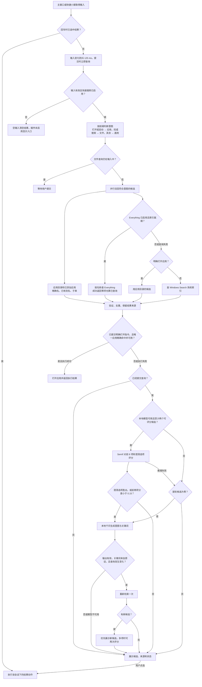
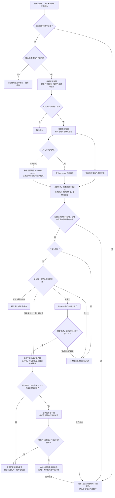

# fasthelper

Windows 11 x64 本地快捷助手。通过「功能管理」按需安装快速搜索。插件可从主窗口侧栏打开，也可通过托盘或 `Ctrl + Shift + Space` 打开紧凑搜索视图。

## 开发

在 Windows x64 上使用 Node.js 22.12 或更新版本。

```powershell
npm ci
npm run dev
```

```powershell
npm test
npm run build
npm run test:desktop
npm run package:win
```

桌面测试使用独立用户目录。`$env:FASTHELPER_TEST_MODEL='1'` 验证 0.8B 的安装和本地推理，`'all'` 验证两档权重及切换。测试结束后会清理下载。标准账户下用 Windows Search 做文件查找，结果范围取决于该账户可见的系统索引。

每轮功能改动验证后运行 `npm run upgrade:local`。脚本构建 Windows 安装包、覆盖当前用户的 fasthelper、校验已安装内容，并更新已安装的快速搜索插件。如果应用原本在运行，升级完成后会重新打开。

## 本地决策与语言理解

- **SemIf 候选评分**在用户提交后读取本地模型对有限选项的下一 token 分数。插件提供候选及描述，面板用分数排列前八个候选。需要澄清或评分不可用时沿用插件顺序。评分用于同一请求内的排序。 [SemIf](https://github.com/r33drichards/SemIf)
- **语言理解**与 SemIf 共用当前选中的 Qwen3.5 权重。设置中可独立安装 **0.8B Q4_0**（约 563 MB）和 **4B Q4_K_M**（约 3.03 GB）。两档共用 `llama.cpp`，只加载当前模型。下载后校验体积与 SHA-256，推理只访问 `127.0.0.1`。旧版 fasthelper 管理的 Qwen3 权重会在升级后首次启动时清理。 [0.8B GGUF](https://huggingface.co/ggml-org/Qwen3.5-0.8B-GGUF) · [4B GGUF](https://huggingface.co/ggml-org/Qwen3.5-4B-GGUF)
- **执行规则**由宿主管理。明确打开指令且唯一精确命中时可以直接启动应用。其余候选由用户点击或用键盘选中后执行。基础应用匹配和文件搜索可以独立使用。

## 搜索链路

现状图对应 fasthelper 0.5.0。设计图用于评审下一版的中英文名称召回。

<details>
<summary>现有流程与「杀戮尖塔」案例</summary>



输入「杀戮尖塔」时，文件索引只召回了一个修改器，同目录游戏本体的文件名使用英文。单候选分支直接展示，因此首轮召回缺口一直存在。当前改写还要求关键词出现在原话里，所以 `SlayTheSpire` 会被校验拒绝。

</details>

### 拟议流程



| 判定 | 依据 |
| --- | --- |
| 查询仍有效 | 同一窗口的新查询取消旧请求。过期结果 ID 随会话清理，返回前再次确认请求未取消。 |
| 可信的精确命中 | 原始请求明确要求打开，Windows 注册应用或用户确认过的便携应用唯一匹配，目标可用。 |
| 符合意图的候选 | 搜游戏主体时，修改器、安装器、卸载器和压缩包作为辅助结果。明确搜索修改器或安装器时，这些分类可以成为有效候选。 |
| 触发查询扩展 | 可查询的索引只返回辅助文件、零有效候选，或 SemIf 给出的有限选项有歧义。索引不可用时显示来源和原因。 |
| 接受模型输出 | 每次最多三个不同于原词的短查询。只接受结构化搜索词及允许的意图。英文名和别名可以来自模型知识。 |
| 模型扩展后的结果 | 补查一次，核验路径或应用 ID，保持分类顺序，用户点选后执行。 |
| 已确认别名 | 将用户选定的名称绑定到具体应用或路径。目标移动或失效时提示重新定位。 |

例子中，「杀戮尖塔」先命中修改器，随后由千问提出 `SlayTheSpire`。Everything 补查若同时找到一代和二代，面板分别显示，两项都由用户选择。这条链路仍使用本地文件索引。

代码入口由 [输入意图](src/shared/intent.ts#L8)、[检索编排](src/main/search.ts#L38)、[后端选择](plugins/quick-search/index.ts#L20)、[候选评分](src/main/semif.ts#L68) 和 [本地查询改写](src/main/language-model.ts#L50) 组成。

## 按需安装与发布

`npm run package:win` 生成独立的 `release/plugins/quick-search.fhplugin` 和 `release/windows/<版本>/` 中的 Windows 安装包。快速搜索包使用 Ed25519 签名，在 Electron 独立进程中执行。没有发布源的本地构建可以从设置导入本次构建生成的插件包。

快速搜索首次使用时默认连接已安装的 Everything 1.4。系统没有兼容版本时，插件自动下载并校验官方便携版，在普通用户权限下建立本地目录索引。索引尚未就绪或 Everything 关闭时，使用 Windows Search。独立安装的 Everything 可断开，插件管理的便携实例可卸载。 [Everything](https://www.voidtools.com/downloads/)

手动覆盖安装时，可在「功能管理」选择「更新插件」并导入新版快速搜索包。Everything 组件与已添加应用继续使用同一份本地数据。插件页面展示组件字节进度、索引就绪和查询来源。桌面测试可用 `FASTHELPER_TEST_EVERYTHING` 指定含官方 `everything.exe` 与 `es.exe` 的目录，再通过 `FASTHELPER_TEST_TRANSFER=1` 实测连接组件下载进度。

正式发布时需要在构建环境配置 `FASTHELPER_PLUGIN_SIGNING_KEY_FILE`（Ed25519 私钥文件）、`FASTHELPER_PLUGIN_URL`（独立插件包的 HTTPS 地址）和 `FASTHELPER_UPDATE_URL`（electron-updater 的 HTTPS 发布目录）。主程序更新使用 Windows Authenticode 签名，签名凭据由 CI 或本地签名环境提供。先上传安装包与差分文件，再更新 `latest.yml`。私钥文件不放入工作区或应用。 [NSIS 自动更新](https://www.electron.build/v26/docs/features/auto-update/)

Vue、Vue Router、Pinia 与 Headless UI 管理界面和状态。签名插件清单声明侧栏入口、至多两个页面和可选的快捷页。宿主渲染统一界面，并按窗口隔离查询和结果权限。快速搜索进程提供候选、来源及索引状态。便携程序可添加为应用，在插件设置页重新定位或移除。

首轮交付内置能力和本地模型管理。语音转写、独立发布的第三方插件及正式签名在后续里程碑。

项目源码采用 MIT 许可。第三方组件适用其各自许可。
